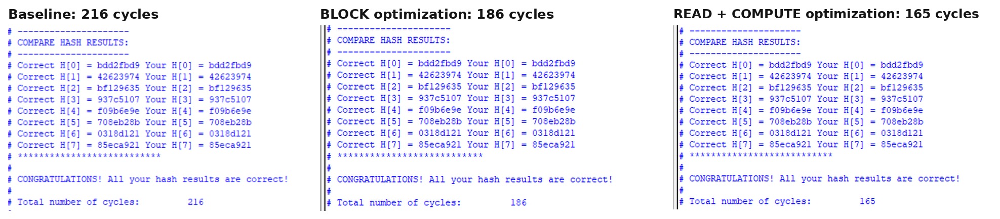
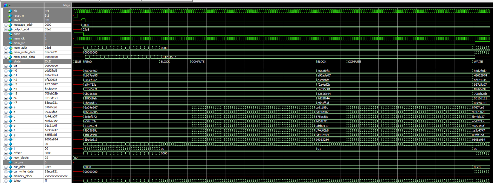
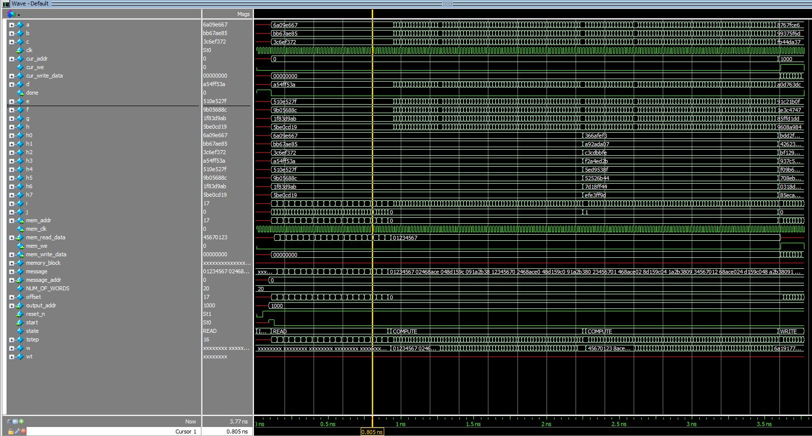
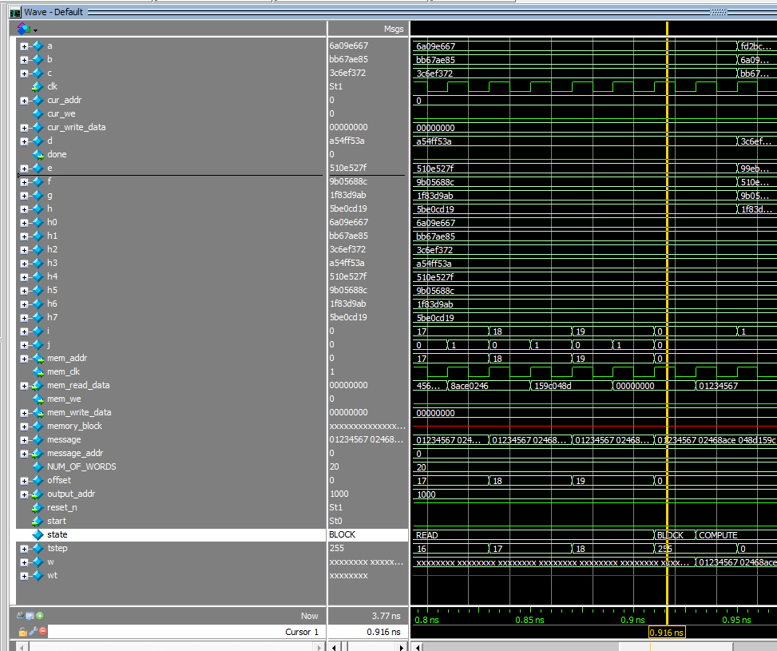

# SHA-256 Hashing Module (SystemVerilog)

A SHA-256 hardware hashing module written in SystemVerilog, synthesized with Intel Quartus, and verified in ModelSim. Every hash output matches the expected values. I optimized it from **216 to about 165 clock cycles per hash** (about 24% fewer) in three stages, measuring the area and timing cost of each change.

## Results

| Version | Cycles per hash | Combinational ALUTs | Registers | Fmax | Time per hash |
|---|---|---|---|---|---|
| Baseline (rolling 16-word schedule) | 216 | 1,817 | 1,743 | 166.78 MHz | 1.30 µs |
| + Single-cycle BLOCK load | 186 | 2,064 (+13.6%) | 1,743 | 172.44 MHz | 1.08 µs |
| + Pipelined READ and no COMPUTE bubble | ~165 | 2,076 (+0.6%) | 1,751 | – | – |

*Time per hash = cycles ÷ Fmax. Fmax and Time per hash will be complete.*



## How the design works

An FSM moves through **IDLE → READ → BLOCK → COMPUTE → WRITE**:

- **READ** pulls the 20 input message words from memory.
- **BLOCK** builds each 512-bit block and applies SHA-256 padding. The 20-word message plus padding fills two blocks.
- **COMPUTE** runs the 64 SHA-256 compression rounds on the working variables `a`–`h` and adds the result into the hash values `h0`–`h7`.
- **WRITE** stores the eight 32-bit hash words back to memory.

## Optimization 1: rolling 16-word message schedule

Rather than storing all 64 expanded message words, the design keeps only a rolling window `w[0..15]`. Each round shifts the window down by one and computes the newest word from `w[0]`, `w[1]`, `w[9]` and `w[14]`. This cuts the message schedule storage by three quarters and is the 216-cycle baseline.



## Optimization 2: loading a whole block in one clock cycle (216 → 186 cycles)

```systemverilog
BLOCK: begin
  for (int n = 0; n < 16; n = n + 1) begin
    if ((j * 16 + n) < NUM_OF_WORDS)
      w[n] <= message[j * 16 + n];               // original message words
    else if ((j * 16 + n) == NUM_OF_WORDS)
      w[n] <= 32'h80000000;                      // first padding bit
    else if ((j * 16 + n) == (num_blocks * 16 - 1))
      w[n] <= NUM_OF_WORDS * 32;                 // message length in bits
    else
      w[n] <= 32'h00000000;                      // zero padding
  end
  // ...load a–h from h0–h7, then go to COMPUTE
end
```

Previously, the BLOCK state had one register incrementing from 0 to 15, and on each clock edge, `i` selected one word to load into `w[i]`. That requires 16 clock cycles to load one 512-bit block. Because the 20-word message plus SHA-256 padding occupies two 512-bit blocks, the BLOCK state is executed twice, resulting in 32 BLOCK-state cycles (2 blocks × 16 cycles) before this optimization. It used the same comparator and mux logic each time, just pointed at a different register each cycle. Since each loaded word is stored in a different register, all 16 writes can be scheduled simultaneously and become available on the next clock tick. As shown above, this is done by using `n` as a loop variable that takes on each value from 0 to 15, all within a single clock edge. This creates 16 independent copies of the same comparator and mux logic, all in parallel and each driving its own register, `w[0]` through `w[15]`. It's a clear win in cycle count, but it costs more area: combinational ALUTs rose 13.6%, from 1,817 to 2,064. Register count stayed the same, and Fmax actually improved slightly, from 166.78 to 172.44 MHz.





From the waveform, the states pass through READ → COMPUTE → COMPUTE → WRITE, with no visible BLOCK segment between them in the first image, because BLOCK is too brief to render at this zoom level. The second, zoomed-in waveform shows a BLOCK segment one clock edge wide. READ still takes about a quarter of the whole hash, 40 cycles, to pull 20 words out of memory. It can't be parallelized the way BLOCK was, because it's bottlenecked by reading external memory through a single-port SRAM: memory can only accept one address and return one word per clock cycle. Once all 20 words are in, the design goes into BLOCK for one clock edge, and then the first COMPUTE takes over. COMPUTE takes most of the time, at 66 cycles per block, and the two COMPUTE passes remain unchanged and identical. Between them, BLOCK runs again for the second block, loading words 16 through 19 along with the SHA-256 padding. This is necessary because it fills the remainder of the second 16-word block with the marker bit that ends the real message, the zero-fill, and the length field.

## Optimization 3: pipelined READ and no COMPUTE bubble (186 → ~165 cycles)

**READ: 40 → about 21 cycles.** READ used two cycles per word, issuing an address and then waiting a cycle for the SRAM to return the data. The single-port SRAM's real limit is one word per cycle, so READ now issues the next address every cycle while capturing the word requested on the previous cycle. Only the first word has to wait.

**COMPUTE: 66 → 65 cycles per block.** Before, COMPUTE skipped a round at `i == 16` to generate the first expanded word. Now the next schedule word is computed combinationally and is always ready, so every cycle runs a compression round:

```systemverilog
assign s0    = rightrotate(w[1], 7)   ^ rightrotate(w[1], 18)  ^ (w[1] >> 3);
assign s1    = rightrotate(w[14], 17) ^ rightrotate(w[14], 19) ^ (w[14] >> 10);
assign w_new = w[0] + s0 + w[9] + s1;
```

## Files

| File | Description |
|---|---|
| `simplified_sha256.sv` | SHA-256 module (the latest version, with all three optimizations) |
| `tb_simplified_sha256.sv` | Testbench: loads a 20-word message, checks all eight hash words, and counts cycles |
| `simplified_sha256.qpf` | Quartus project file |

**To run:** open the project in Quartus Prime (22.1) to synthesize, or compile both `.sv` files in ModelSim and run `tb_simplified_sha256` to see the hash comparison and cycle count.

## Notes

Built for the ECE 111 (Advanced Digital Design) final project at UC San Diego, as a three-person team. I implemented and optimized the SHA-256 module; teammates built the Bitcoin hashing extension on top of it. The testbench and module interface were provided by the course.
